# NeuroRL

**Neuromodulated reinforcement learning with graph transformations for configurable multi-robot teaming.**

A centralized PPO policy edits the **inter-robot adjacency graph** rather than commanding velocities; a decentralized Laplacian controller turns the edited graph into robot motion. A neuromodulated intrinsic reward, built from two health signals (group health and per-robot health), is the interface through which an operator states team priorities — survivability, path efficiency, behavioral assimilation, or symmetric formation — **without editing the objective, the task, the map, or the controller.**

This repository publishes the **evaluation results and demonstration videos** for the paper *"NeuroRL: Neuromodulated Reinforcement Learning with Graph Transformations for Robot Teaming,"* submitted to *The International Journal of Robotics Research*.

**The source code will be up soon.**

---

## See it first

NeuroRL commanding a three-rover team: the graph is re-formed into a line to clear a corridor, then back into a symmetric ring once through.

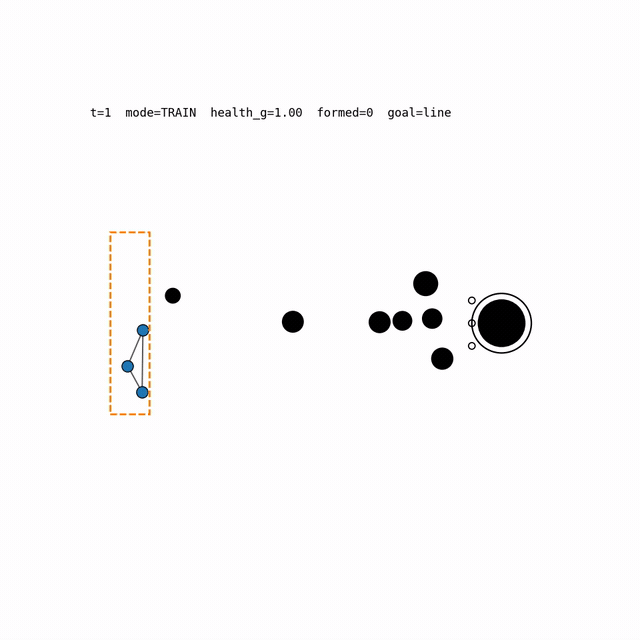

A full scored evaluation episode, with the health traces and the formation gate visible in the HUD.

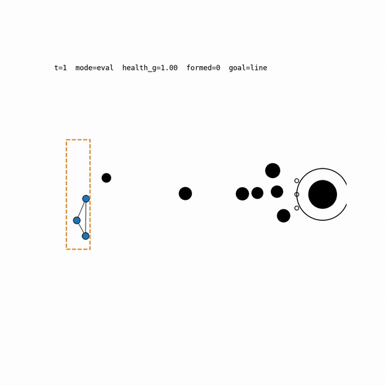

---

## Abstract

Planetary exploration increasingly relies on robot teams to perform infrastructure, inspection, and navigation tasks in environments that are unsafe or inaccessible to humans. To verify robot survivability and that critical systems function as intended, robot teaming relies on autonomy that yields interpretable and configurable behavioral strategies. Deterministic controllers can produce explainable behavior, but they often lack adaptability in novel or changing terrain. This paper combines graph representations with reinforcement learning to capture team relations and adapt multi-robot behavior across a hierarchy of navigation objectives. Drawing inspiration from biological neuromodulation, behavioral explainability is grounded in geometric relations within the graph, while configurability arises through a neuromodulated reinforcement pipeline that intrinsically motivates task-agnostic strategy within the graphical transformations (NeuroRL). We test the graph-transformation performance in a Martian simulation and a real-world sandbox using a team of LEO Rovers. Results show that NeuroRL maintains high navigation success while producing configurable tradeoffs among survivability, behavioral assimilation, and symmetric formation, obtained without altering the reinforcement objective itself.

---

## Contributions

1. **A neuromodulated RL framework for interpretable multi-robot teaming.** NeuroRL couples a centralized graph-level PPO policy with decentralized Laplacian consensus control, so that learned team strategies remain expressed as interpretable geometric structure from training through deployment.

2. **Graph transformation as the action space.** The policy reshapes inter-robot adjacency relations through bounded multiplicative, additive, and subtractive masks, lifting the RL action from individual motion to team structure.

3. **Health-based neuromodulated intrinsic reward.** A biologically inspired intrinsic reward, grounded in group health and robot health, makes the return a function of health alone. Team behavior is reconfigured by changing how health is earned and spent, with the objective, task, map, controller, and training budget held fixed.

4. **Modular attribution of behavioral effects.** The framework separates what the reward configures from what the controller configures: the intrinsic weights shift team health and hazard exposure without altering the controller, while a single avoidance gain trades formation for throughput without altering the reward, attributing each effect to its true source.

---

## Results

### Comparison to learned multi-agent coordination baselines

Mean ± std over 360 episodes per framework across six obstacle-density levels. All four controllers receive identical observations and identical episode budgets. **Bold** marks the best value in each row.

| | Metric | NeuroRL | MAGIC | DCG | MAPF |
|---|---|---|---|---|---|
| **Task** | Task success (%) | **83.6** | 35.6 | 62.2 | 59.7 |
| | Completion time (s) | 25.09 ± 8.77 | 45.37 ± 11.96 | 17.62 ± 1.46 | **15.91 ± 1.36** |
| | Steps to success | 502 ± 175 | 907 ± 239 | 352 ± 29 | **318 ± 27** |
| **Safety** | Contact-free episodes (%) | **100.0** | 79.2 | 97.5 | 29.2 |
| | Contacts per episode | **0.00 ± 0.00** | 17.71 ± 86.57 | 0.26 ± 2.24 | 15.55 ± 13.55 |
| | Barrier-free episodes (%) | **87.2** | 0.0 | 0.6 | 0.0 |
| | Barrier steps per episode | **1.68 ± 5.60** | 545.19 ± 573.86 | 632.61 ± 633.55 | 656.77 ± 646.43 |
| **Formation** | Cohesion (%) | **95.13 ± 4.34** | 47.40 ± 32.60 | 43.46 ± 36.11 | 53.21 ± 35.52 |
| | Symmetry (%) | **85.58 ± 6.07** | 64.14 ± 9.19 | 66.98 ± 7.42 | 65.04 ± 8.79 |
| | Node angle (deg) | **20.69 ± 10.27** | 45.10 ± 12.61 | 45.76 ± 9.71 | 46.03 ± 13.15 |
| | Time in formation (%), mean | **36.74 ± 27.63** | 0.12 ± 0.77 | 1.06 ± 1.71 | 0.38 ± 4.68 |
| | &nbsp;&nbsp;median [IQR] | **28.57 [15.84, 52.10]** | 0.00 [0.00, 0.00] | 0.00 [0.00, 2.03] | 0.00 [0.00, 0.00] |
| **Path** | Length (m) | 5.20 ± 1.41 | 5.40 ± 1.22 | 4.68 ± 0.62 | **4.20 ± 0.78** |
| | Variance (%) | **8.46 ± 3.18** | 15.67 ± 17.49 | 22.32 ± 20.19 | 20.75 ± 19.74 |

NeuroRL is the only framework with **zero contacts across all 360 episodes**, and it holds cohesion at 95.13% against 43.46–53.21% for the baselines (δ ≥ 0.82, *p* < 10⁻¹²). Under the strict criterion requiring every vertex angle within 5° of the ideal 60°, it spends 36.74% of the episode in formation against 0.12–1.06% for the baselines.

### Degradation with clutter — learned baselines

Task success per obstacle-density level: 60 held-out seeds each, layouts resampled per seed. Coverage is the mean fraction of map area lying inside an obstacle. Superscripts mark a two-sided Fisher exact test of that framework against NeuroRL at the same level (\* *p*<0.05, † *p*<0.01, ‡ *p*<0.001). Retention is *S*(8.5%)/*S*(2.4%).

| Coverage (Obst.) | NeuroRL | MAGIC | DCG | MAPF |
|---|---|---|---|---|
| 2.4% (8) | **98.3** | 51.7 ‡ | 88.3 | 88.3 |
| 3.7% (12) | **95.0** | 40.0 ‡ | 76.7 † | 83.3 |
| 4.9% (16) | **88.3** | 45.0 ‡ | 71.7 \* | 70.0 \* |
| 6.1% (20) | **81.7** | 41.7 ‡ | 60.0 \* | 51.7 ‡ |
| 7.4% (24) | **73.3** | 23.3 ‡ | 48.3 † | 40.0 ‡ |
| 8.5% (28) | **65.0** | 11.7 ‡ | 28.3 ‡ | 25.0 ‡ |
| **Retention (%)** | **66.1** | 22.6 | 32.1 | 28.3 |

### Degradation with clutter — classical planners

Both A\* columns are **privileged with the ground-truth obstacle map**, so the Agent A\* row measures what an exact search achieves with information the learned policy does not have. The retention row is the change in percentage points from 2.4% to 8.5% coverage.

| Coverage (Obst.) | NeuroRL | MA-PF | MA-A\* | Agent A\* |
|---|---|---|---|---|
| 2.4% (8) | 98.3 | 88.3 | 83.3 † | 100.0 |
| 3.7% (12) | 95.0 | 83.3 | 70.0 ‡ | 100.0 |
| 4.9% (16) | 88.3 | 70.0 \* | 68.3 \* | 100.0 \* |
| 6.1% (20) | 81.7 | 51.7 ‡ | 53.3 † | 100.0 ‡ |
| 7.4% (24) | 73.3 | 40.0 ‡ | 51.7 \* | 100.0 ‡ |
| 8.5% (28) | 65.0 | 25.0 ‡ | 25.0 ‡ | 100.0 ‡ |
| **Retention (pp)** | **−33.3** | −63.3 | −58.3 | 0.0 |

The two unprivileged-geometry baselines do not degrade gracefully: MA-PF loses 63.3 points and MA-A\* 58.3 points between 2.4% and 8.5% coverage, both ending at 25.0%. NeuroRL loses 33.3 points and ends at 65.0%.

### Reward configurability

Means over four independent training runs, ± the standard deviation across the four run means. Each row raises one intrinsic weight above the balanced baseline (×3, or ×4 for the path-efficiency pair); **everything outside the reward is held fixed**. **Bold** marks a configuration that separates completely from the baseline in the exact run-level permutation test at *p* = 0.029.

| Configuration | Task success | Minimum agent health | In formation ≤5° (%) | Angle RMSE (deg) | Symmetry (%) |
|---|---|---|---|---|---|
| Balanced | 0.806 ± 0.020 | 0.478 ± 0.005 | 42.25 ± 4.66 | 20.11 ± 0.83 | 85.93 ± 0.60 |
| α<sub>ζ</sub> ×3 | 0.807 ± 0.004 | **0.539 ± 0.008** | 44.43 ± 2.31 | 19.48 ± 0.63 | 86.38 ± 0.44 |
| α<sub>σ</sub> ×3 | 0.794 ± 0.019 | **0.228 ± 0.017** | 52.66 ± 4.71 | **16.80 ± 1.49** | 88.10 ± 0.93 |
| α<sub>edit</sub> ×3 | 0.815 ± 0.016 | **0.443 ± 0.020** | **31.02 ± 0.89** | **23.99 ± 2.12** | **83.46 ± 1.51** |
| α<sub>τ</sub>, α<sub>G</sub> ×4 | 0.803 ± 0.008 | 0.472 ± 0.004 | 39.02 ± 5.86 | 21.54 ± 1.66 | 85.18 ± 1.02 |

Task success is statistically unchanged across every configuration (0.794–0.815) while health, formation and symmetry move in the commanded direction — the configurability claim in one table.

---

## Demos

Every demo is rendered from a recorded evaluation episode. **No demo is a best case:** within each bucket the episode closest to that bucket's *median* time in formation was selected. Demos run past the scored end of the episode until the rovers park on their goal markers; those extra frames are labelled `settling, +N steps not scored` in the HUD and change no reported number. A demo that ends with the team mid-map is a timeout at the step horizon, not a truncated render.

> **Health is NeuroRL's objective and no baseline's.** The HUD shows a health trace for every controller because health is environment state, but the baselines carry no health term (`r_intrinsic == 0`). Read their trace as the cost of their route choice, not as a score they were pursuing.

### Framework comparison across the difficulty ladder

The video counterpart of the paper's showcase grid. Within a row, all four frameworks run the **same level, same seed, and therefore the same sampled layout, start jitter and corridor** — so the rows are direct comparisons. Rows come in three kinds: **fair** (all frameworks finish), **trade** (outcomes diverge), and **only** (NeuroRL is the only framework to finish).

| | NeuroRL | MAGIC | DCG | MAPF |
|---|---|---|---|---|
| **2.4% sparse** <br> *fair* | 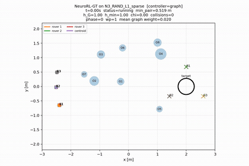 <br> 339 steps, 0 contacts | 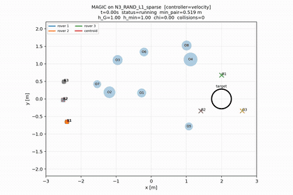 <br> timeout, 89 contacts | 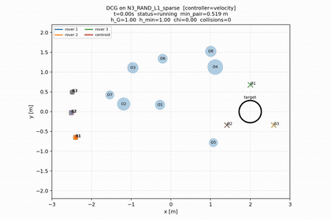 <br> finishes, 0 contacts | 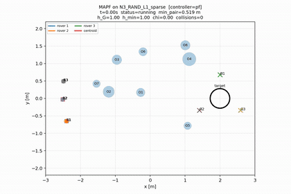 <br> finishes, 20 contacts |
| **3.7% moderate** <br> *fair* | 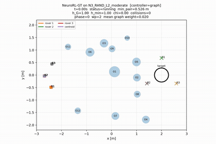 <br> 336 steps, 0 contacts | 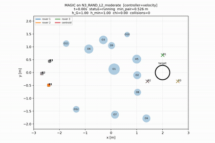 <br> finishes, 0 contacts | 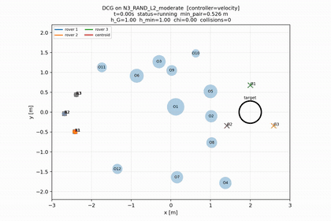 <br> finishes, 0 contacts | 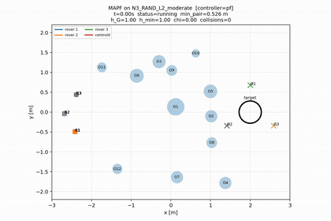 <br> finishes, 27 contacts |
| **4.9% dense** <br> *fair* | 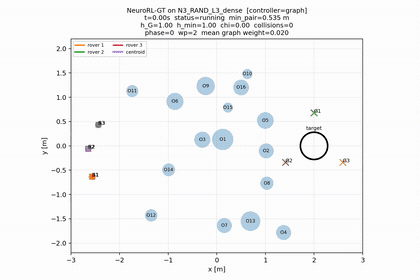 <br> 363 steps, 0 contacts | 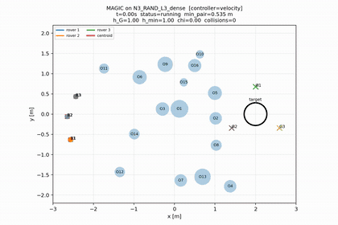 <br> timeout, 119 contacts |  <br> finishes, 0 contacts | 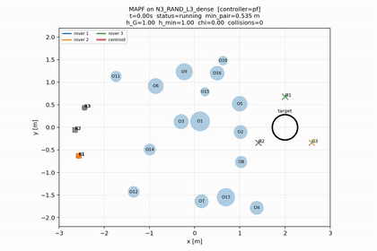 <br> finishes, 0 contacts |
| **6.1% severe** <br> *trade* | 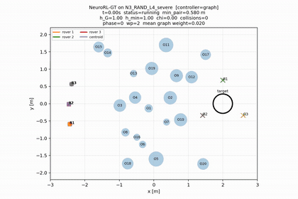 <br> 461 steps, 0 contacts | 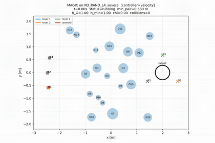 <br> timeout | 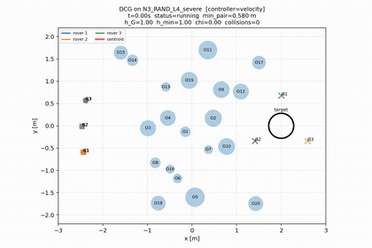 <br> finishes, 0 contacts | 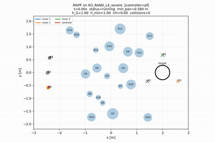 <br> finishes, 34 contacts |
| **7.4% extreme** <br> *trade* | 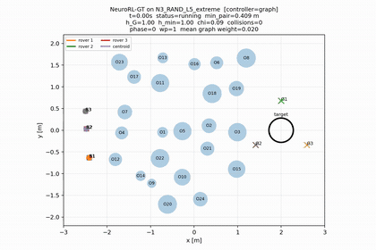 <br> 954 steps, 0 contacts | 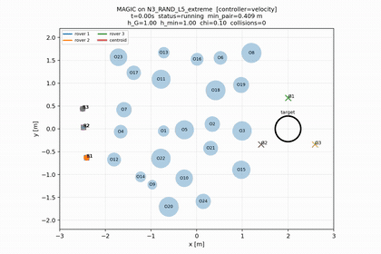 <br> finishes, 0 contacts | 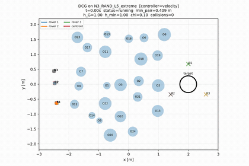 <br> finishes, 0 contacts | 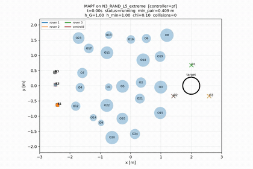 <br> finishes, 41 contacts |
| **8.5% saturated** <br> *trade* | 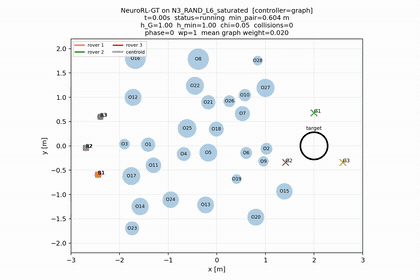 <br> 539 steps, 0 contacts | 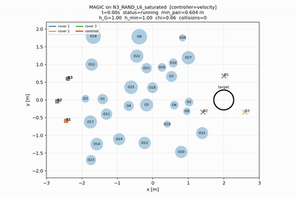 <br> timeout | 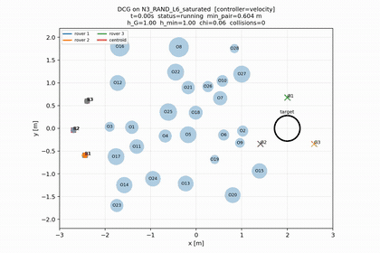 <br> finishes, 0 contacts |  <br> finishes, 25 contacts |
| **6.1% severe** <br> *only* | 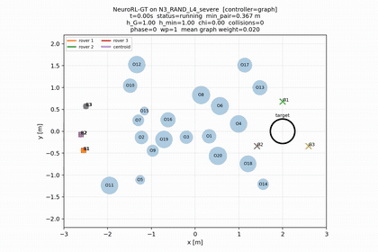 <br> 548 steps, 0 contacts | 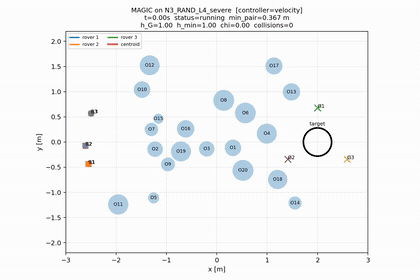 <br> timeout, 17 contacts | 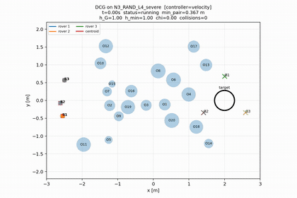 <br> timeout | 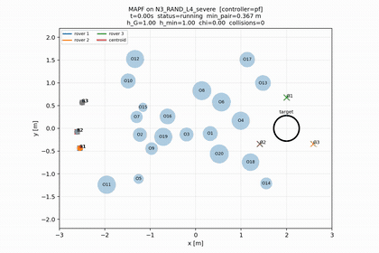 <br> timeout |
| **7.4% extreme** <br> *only* |  <br> 462 steps, 0 contacts | 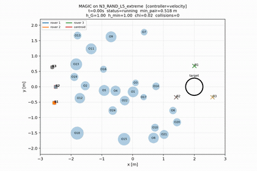 <br> timeout | 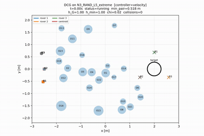 <br> timeout | 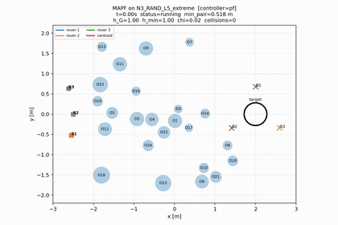 <br> timeout |
| **8.5% saturated** <br> *only* | 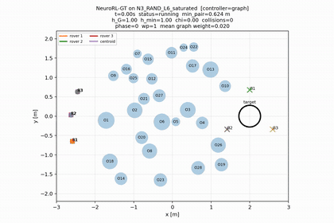 <br> 671 steps, 0 contacts | 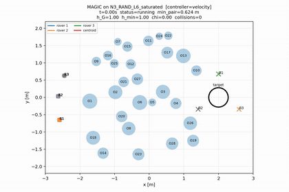 <br> timeout | 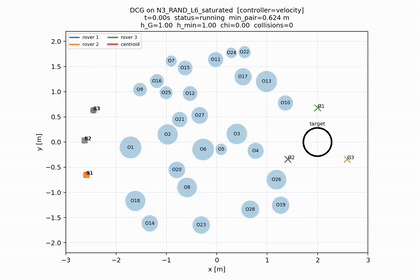 <br> timeout | 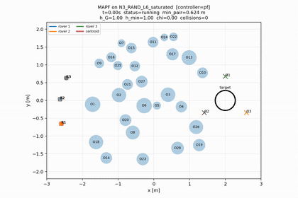 <br> timeout |

Full per-row measured outcomes, including minimum health and time in formation for every framework: [`demos/showcase/outcomes.md`](demos/showcase/outcomes.md).

### Classical planners across the difficulty ladder

The video counterpart of the paper's classical grid. One representative episode per planner per level. Both A\* planners are privileged with the ground-truth obstacle map.

The NeuroRL column is a **final-state still**, not an animation: this comparison batch was rendered as stills for NeuroRL and as animations for the three planners, so the animations are not yet available at matched seeds. NeuroRL in motion at every one of these difficulty levels is in the [framework comparison](#framework-comparison-across-the-difficulty-ladder) above.

| | NeuroRL *(still)* | MA-PF | MA-A\* | Agent A\* |
|---|---|---|---|---|
| **2.4% sparse** | 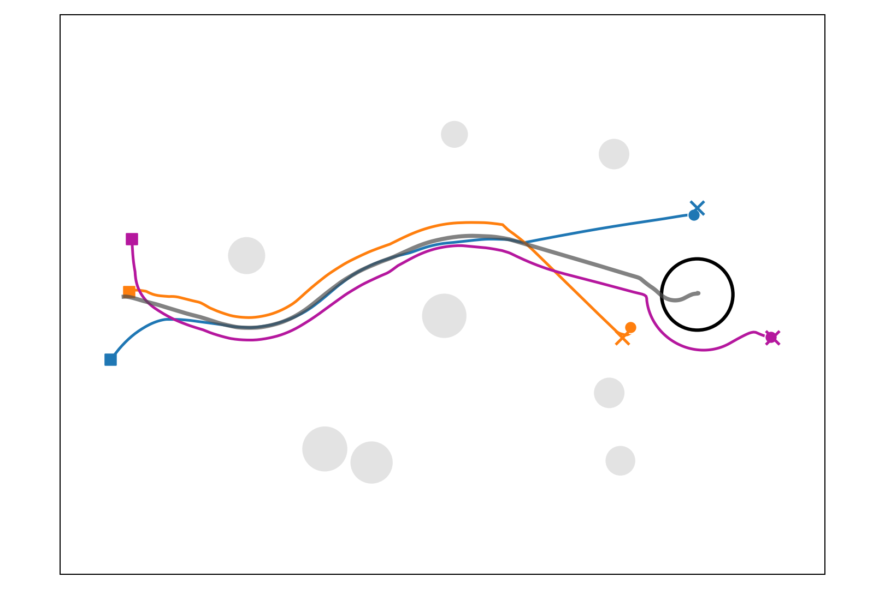 | 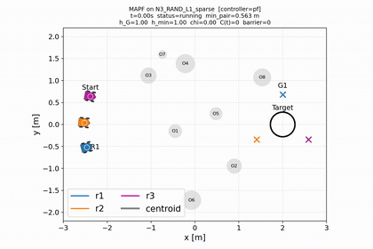 | 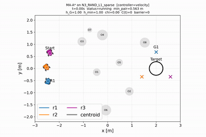 | 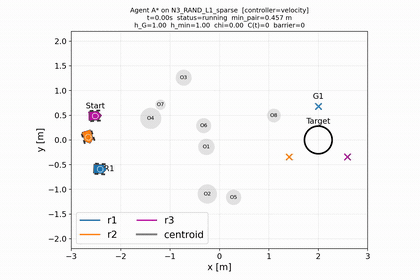 |
| **3.7% moderate** | 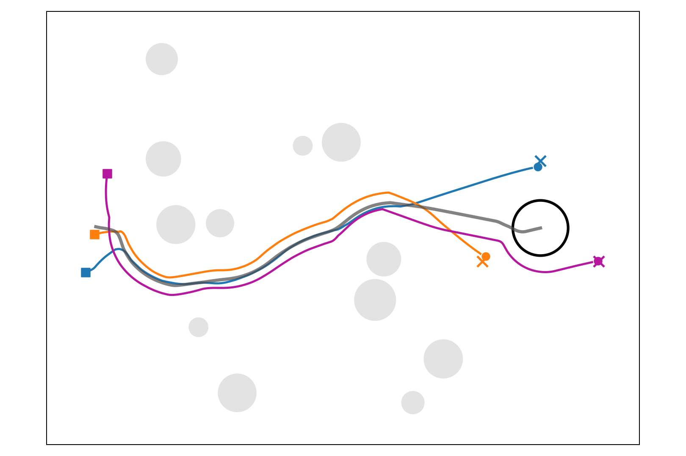 | 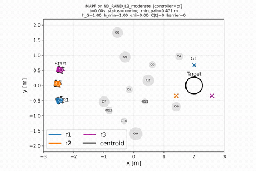 | 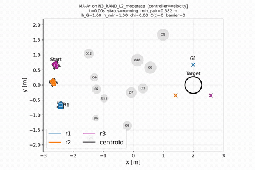 | 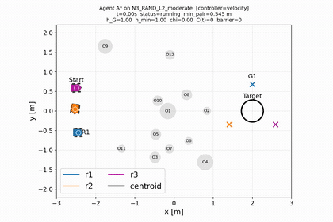 |
| **4.9% dense** | 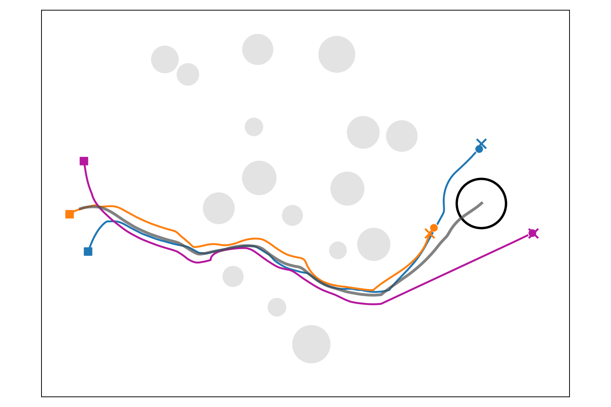 | 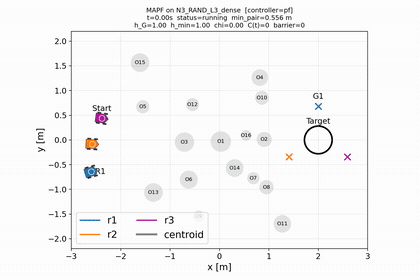 | 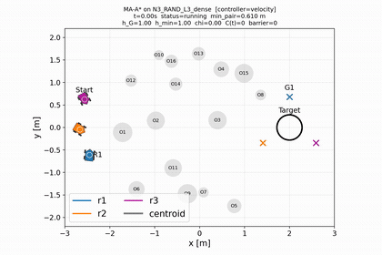 | 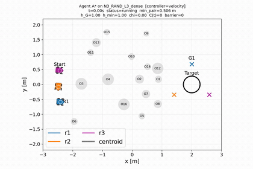 |
| **6.1% severe** | 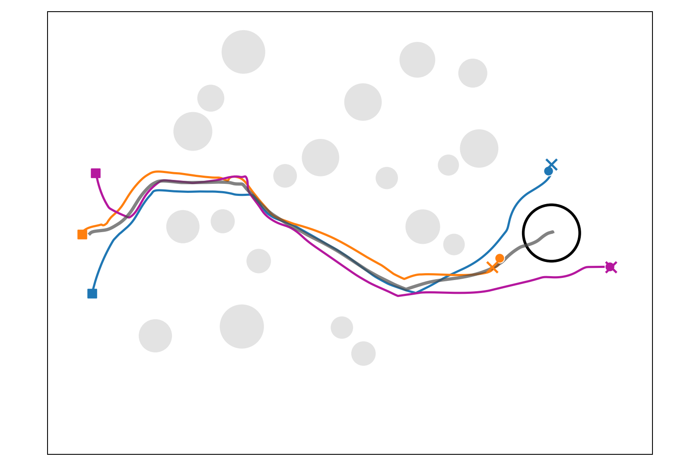 | 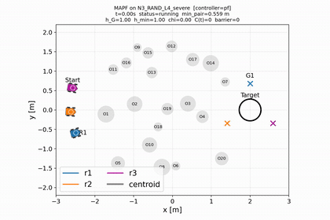 | 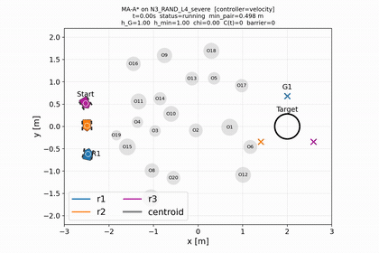 |  |
| **7.4% extreme** |  |  |  |  |
| **8.5% saturated** |  |  |  |  |

### Configurability

The same policy architecture, the same map, the same goal-pose structure — only the intrinsic reward weights differ. These are the demos behind the reward-configurability table.

| Balanced | Assimilation prioritized | Avoidance gain raised |
|---|---|---|
|  |  |  |
| balanced intrinsic weights, 3 rovers, 7.4% coverage | behavioral assimilation prioritized — inter-robot path variance falls | formation traded for throughput, reward untouched |

The three configurations side by side on one seed:


Four rovers negotiating a corridor:


Each configuration also has a fixed-seed variant (`*-fixed-seed.gif`) for frame-matched comparison.

---

## Repository layout

```
demos/
├── highlights/        the two demos at the top of this page
├── showcase/          9 rows x 4 frameworks, same seed within a row
│   └── outcomes.md    per-row measured outcomes
├── classical/         3 planners x 6 difficulty levels, plus NeuroRL stills
└── configurability/   reward configurations on a fixed map
```

Each demo is published as an animated `.gif` for inline viewing and as the source `.mp4` at full resolution under the same name.

## Citation

Daniel de la Calle, Dang Tran, Sharlene Newman, Amir Rahmani, and Hongsheng He. *NeuroRL: Neuromodulated Reinforcement Learning with Graph Transformations for Robot Teaming.* Submitted to The International Journal of Robotics Research.

The University of Alabama; NASA Jet Propulsion Laboratory.
